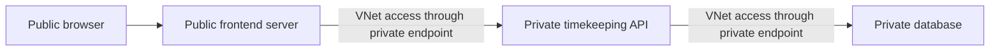
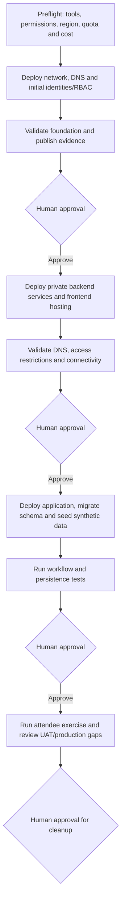

# guard-timekeeping
Digital timekeeping proof of concept for a security guard workforce.

## Four-hour workshop

Start with [the workshop plan](plan.md). It records the agreed architecture,
application scope, deployment stages, agenda and implementation gates. The rest of
this README predates that plan and is rewritten in gate G6.

This repository will contain a DEV proof-of-concept timekeeping app and a guided
Azure workshop. The design interview is still in progress. No application,
Bicep templates, or deployment gates have been implemented yet.

### Agreed constraints

- The workshop must take no more than four hours and suit people new to Azure.
- Build a new application and infrastructure. Use the two sample repositories
  as references, not as a finished timekeeping system.
- Provision Azure resources with Bicep. Do not use AKS.
- Use prepopulated synthetic data only. This is not a production payroll system.
- Keep the frontend publicly reachable and the backend behind private endpoints.
  Whether public reachability also means anonymous access is still open.
- Deploy in stages. After each stage, show validation evidence and stop for
  human approval before proceeding.
- Document the exercises, expected results, diagrams, troubleshooting, cleanup,
  and work needed before UAT or production.

The [decision record](docs/decisions/0001-dev-workshop-boundaries.md) separates
confirmed requirements from open choices. The [glossary](docs/glossary.md) defines
the terms used in this workshop.

### Proposed request path

This diagram assumes that both the API and database must be private. It is a
proposal, not an approved service selection.

The browser calls the public frontend. The frontend calls the private API on the
browser's behalf. A static page running in an internet browser cannot directly
reach a private endpoint. Private networking does not replace authentication or
authorization.

The API needs outbound connectivity to the database as well as its inbound private
endpoint. The deployment process also needs a way to reach private code-deployment
endpoints and run database migrations and seeding. These paths must be tested before
the workshop. Opening the backend firewall is not an approved workaround.

### Proposed deployment gates

These are application-environment stages, not a complete enterprise landing zone.
The approval mechanism and exact resource boundaries are still open.

No approval means no next stage. A failed validation must stop the process.
Each approval should identify the environment, source revision, deployment
parameters, and validation results. A changed deployment needs fresh validation
and approval. Resource-specific role assignments may need to follow resource
creation rather than belong to the first stage.

Before implementation, settle:

- What "from scratch" means during the four-hour session versus facilitator
  preparation beforehand.
- Whether the private-backend requirement includes a separately hosted API.
- Whether the public frontend allows anonymous demo personas or requires sign-in.
- Whether approvals use separate local commands or GitHub Actions environments.
- The target Azure cloud and the workshop's environment count and spending limit.

### Reference findings

The customer deck describes a 24-hour hackathon. This workshop has a four-hour
limit, so it cannot promise the full proposed application.

The FastAPI sample contains a restaurant-review application with App Service and
PostgreSQL infrastructure. It needs new timekeeping behavior, validation and tests.
The PostgreSQL workshop is a collection of lessons, including topics outside this
workshop's scope. Neither repository is a ready-to-use timekeeping application.

The four architecture images add progressively more services. Real payroll
integration, push notifications, event processing and multi-region recovery should
not become workshop requirements just because they appear in those diagrams.
Their inclusion remains subject to explicit scope decisions.

Technical references:

- [App Service VNet integration](https://learn.microsoft.com/azure/app-service/overview-vnet-integration)
  explains outbound access. It does not make inbound API access private.
- [App Service private endpoints](https://learn.microsoft.com/azure/app-service/overview-private-endpoint)
  covers inbound access, separate integration and endpoint subnets, and private
  DNS for the app and its SCM deployment endpoint.
- [PostgreSQL Private Link](https://learn.microsoft.com/azure/postgresql/network/concepts-networking-private-link)
  differs from PostgreSQL's delegated-subnet private-access mode.
- [GitHub deployment protection rules](https://docs.github.com/en/actions/reference/workflows-and-actions/deployments-and-environments)
  describes required reviewers and repository-plan restrictions. A workflow file
  alone does not configure required reviewers.

## MCP servers (preconfigured)

This repo ships with MCP server configs, so GitHub Copilot picks them up automatically when you open or clone it. No manual setup is needed.

| Server | What it gives Copilot | Type |
|---|---|---|
| `azure` | Azure MCP: manage and query Azure resources, best practices, Bicep and Terraform guidance | local (`npx @azure/mcp`) |
| `microsoft-learn` | Latest Microsoft/Azure docs and code samples | remote HTTP |
| `github` | GitHub repos, issues, PRs, Actions (VS Code only; built into Copilot CLI) | remote HTTP |
| `playwright` | Browser automation for UI testing | local (`npx @playwright/mcp`) |

Config files:
- **VS Code (Copilot Chat / Agent mode):** [.vscode/mcp.json](.vscode/mcp.json). Open the repo, then click **Start** on each server in the file, or run `MCP: List Servers`.
- **Copilot CLI:** [.github/mcp.json](.github/mcp.json). Run `copilot` from the repo folder and check it with `/mcp`.

### Prerequisites
- [Node.js](https://nodejs.org/) LTS (for `npx`)
- [Azure CLI](https://learn.microsoft.com/cli/azure/install-azure-cli), signed in with `az login` (the Azure MCP uses your Azure CLI credentials)
- GitHub sign-in in VS Code / Copilot CLI
