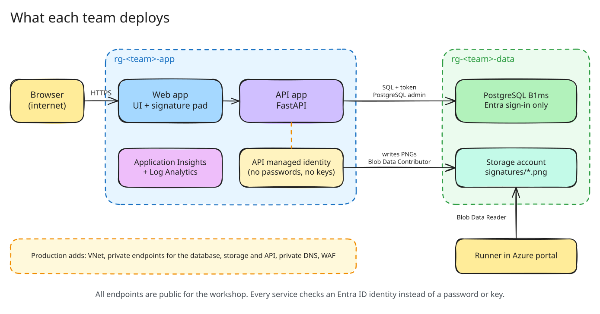
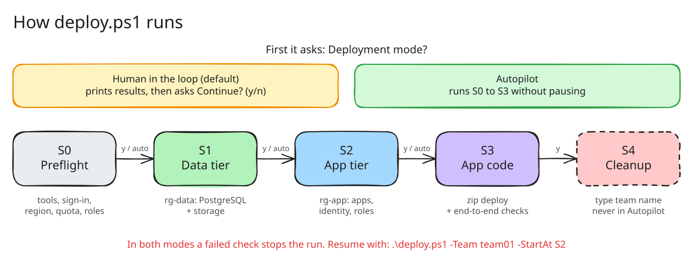
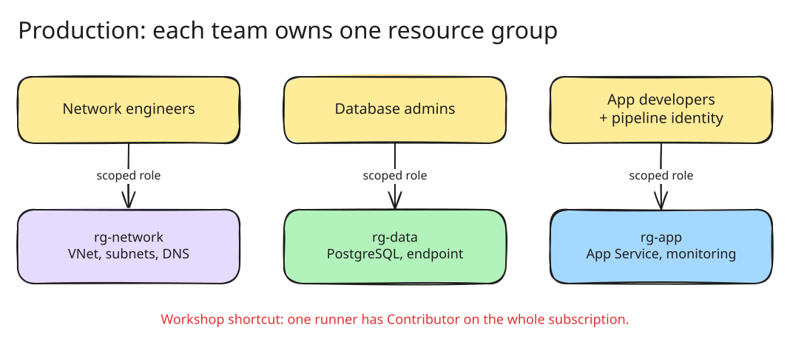

# guard-timekeeping

A four-hour Azure workshop. Each team uses Bicep to deploy a three-tier
timekeeping app for a security-guard workforce, one stage at a time. The app uses
synthetic data only.

> Status: the [plan](plan.md) is agreed. The scripts, Bicep templates and app are
> being built and tested gate by gate. Commands below work once gate G5 is done.

## What you deploy



| Tier | Resource group | Azure service | Who can reach it |
|---|---|---|---|
| Web | `rg-<team>-app` | App Service, Linux B1 | The internet |
| API | `rg-<team>-app` | App Service, same plan | The web app's subnet only |
| Database | `rg-<team>-data` | PostgreSQL Flexible Server, B1ms | The private endpoint only |
| Network | `rg-<team>-network` | VNet, two subnets, private DNS zone | Not applicable |

The API signs in to PostgreSQL with its managed identity, so no database password
exists anywhere.

## How deployment runs



```powershell
git clone https://github.com/lenvolk/guard-timekeeping.git
cd guard-timekeeping
.\scripts\Test-Prerequisites.ps1
.\deploy.ps1
```

The script asks for any value you leave out. Press Enter to accept the default.

| Parameter | Default |
|---|---|
| `-Team` | `team01` |
| `-SubscriptionId` | Your current `az account` subscription |
| `-Location` | `eastus2` |
| `-VnetPrefix` | `10.20.0.0/16` |
| `-StartAt` | `S0` |

For a hackathon, `.\scripts\Test-Prerequisites.ps1 -TeamCount 5` checks regional
quota for five teams. Give each team its own `-Team` name.

## Prerequisites

- Windows PowerShell 5.1 or PowerShell 7
- [Azure CLI](https://learn.microsoft.com/cli/azure/install-azure-cli) with Bicep (`az bicep install`)
- Contributor on the Azure subscription
- git, or this repository downloaded as a zip

## Try the app

Open the web URL that S4 prints. Pick a site and a guard. Start a shift, take a
post, hand the post to a relief guard and end the shift. The supervisor page shows
which posts are covered and the event history.

## Clean up

S5 deletes all three resource groups. To run only the cleanup:

```powershell
.\deploy.ps1 -Team team01 -StartAt S5
```

## Before production



This workshop takes shortcuts. Production needs at least:

- scoped roles per resource group instead of one subscription Contributor
- Entra sign-in instead of picking a persona
- a private endpoint on the API and a deployment runner inside the VNet
- least-privilege database roles and versioned migrations
- CI/CD with protected environments instead of laptop prompts
- a WAF, zone redundancy, tested backups and alerts
- approved labor, break and pay rules

Section 11 of the [plan](plan.md#11-production-follow-up) has the full list.

## Diagrams

The diagrams are `.excalidraw.svg` files. GitHub shows them as images, and the
[Excalidraw VS Code extension](https://marketplace.visualstudio.com/items?itemName=pomdtr.excalidraw-editor)
opens them for editing. To regenerate them from code, run `npm install` and
`node render.mjs` in [tools/diagrams](tools/diagrams). This needs Node.js and
Microsoft Edge.

## Copilot setup for contributors

The repository includes MCP server settings for GitHub Copilot. Attendees do not
need them.

| Server | Gives Copilot | Runs |
|---|---|---|
| `azure` | Azure resource queries, Bicep and Terraform guidance | `npx @azure/mcp` |
| `microsoft-learn` | Microsoft and Azure docs and code samples | Remote HTTP |
| `github` | Repositories, issues, pull requests, Actions (VS Code only) | Remote HTTP |
| `playwright` | Browser automation for UI tests | `npx @playwright/mcp` |

VS Code reads [.vscode/mcp.json](.vscode/mcp.json). Start each server from that
file or run `MCP: List Servers`. Copilot CLI reads [.github/mcp.json](.github/mcp.json).
Check it with `/mcp`. Both need Node.js LTS, the Azure CLI signed in with
`az login`, and a GitHub sign-in.

## License

[MIT](LICENSE)
