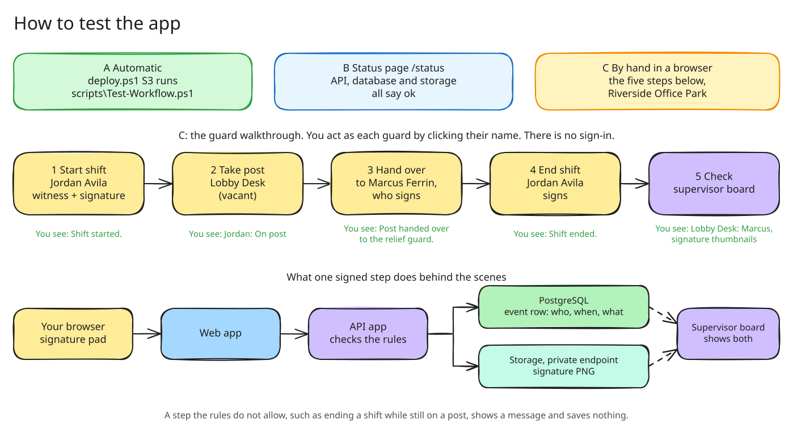

# Demo: test the timekeeping app

Use this after `deploy.ps1` finishes S3. It shows three ways to check that the app
works, from fully automatic to clicking through it yourself. Allow about 15 minutes.



## What you are testing

| Piece | Azure service | It works when |
|---|---|---|
| Web app | App Service in `rg-<team>-app` | The site opens over HTTPS and the signature box draws |
| API | App Service in `rg-<team>-app` | Actions save, and actions the rules forbid are refused |
| Database | PostgreSQL in `rg-<team>-data` | Guards, posts and events appear and stay after a refresh |
| Signatures | Storage account in `rg-<team>-data`, reached through a private endpoint | Signature thumbnails show on the supervisor board |

`<team>` is the team name you gave `deploy.ps1`, for example `team01`.

## Find your web address

S3 prints it at the end, for example
`Website: https://app-team01-web-abcde.azurewebsites.net`. If you lost it, run:

```powershell
az webapp list --resource-group rg-team01-app --query "[].defaultHostName" -o tsv
```

The name with `-web-` is the site you open. The `-api-` app has no pages.

## A. Automatic checks

S3 already ran these. Every line should say `[PASS]`:

- `Web /healthz`: the web app is running.
- `Web /status`: the API, database and signature storage answer.
- `Seed data`: 2 sites, 4 posts and 12 guards were loaded.
- `Test-Workflow.ps1`: a full guard workflow with signatures, run over HTTP.

To run the workflow test again at any time:

```powershell
.\scripts\Test-Workflow.ps1 -WebUrl https://app-team01-web-abcde.azurewebsites.net
```

It uses the last site, Lakeshore Distribution Center, so Riverside Office Park
stays ready for the walkthrough in part C.

## B. Status page

Open `https://<your web address>/status`. Every row should say **ok**:

| Row | What it proves |
|---|---|
| Web app | The site you opened is running |
| API | The web app can call the API |
| Database | The API signed in to PostgreSQL with its managed identity, no password |
| Signature storage | The API reached Blob Storage through the private endpoint |
| Seed data | 2 sites, 4 posts, 12 guards |

## C. Walk through it in a browser

There is no sign-in. You act as a guard by clicking their name on the home page.
Use **Riverside Office Park**. A new deployment starts like this:

- Priya Hollis is on the Main Gate post.
- Marcus Ferrin is on shift with no post, so he can act as a relief guard.
- Lobby Desk is vacant.

Each signature box needs a drawing. Use the mouse, a pen or a finger. The submit
button stays grey until you sign.

1. **Start a shift.** On the home page, click **Jordan Avila**. Under *Start shift*,
   pick any other guard as the witness, tick **Equipment on**, sign, then click
   **Start shift**.
   You see: *Shift started.* Recent activity shows the event with your signature.
2. **Take a post.** Under *Take a post*, choose **Lobby Desk**, then click
   **Take post**.
   You see: Jordan is on post at Lobby Desk.
3. **Hand over the post.** Under *Hand over Lobby Desk*, pick **Marcus Ferrin** as
   the relief guard. The signature box is now Marcus's: he signs to accept the
   post. Click **Hand over post**.
   You see: *Post handed over to the relief guard.*
4. **End the shift.** Tick **Equipment off**, sign as Jordan, then click
   **End shift**.
   You see: *Shift ended.* Jordan is off shift.
5. **Check the supervisor board.** Click **Supervisor board** at the top of the
   page. The board refreshes every 10 seconds.
   You see: Lobby Desk is covered by Marcus Ferrin, Jordan Avila is off shift, and
   the recent events have signature thumbnails.

The thumbnails are the proof that storage works. The browser loads each one from
the web app, which asks the API, which reads the PNG from Blob Storage through the
private endpoint.

### Try the rules (optional)

The API refuses actions that break the rules, shows a message and saves nothing:

- Open a guard who is on a post and try **End shift**:
  *"… is still on … Hand the post to a relief guard before ending the shift."*
- As a guard who is on shift, pick a post someone else covers and click
  **Take post**: *"… is already covered by …"*

## See the data in the Azure portal (optional)

1. Go to <https://portal.azure.com> and sign in with the account that ran
   `deploy.ps1`.
2. Open **Resource groups**, then `rg-<team>-data`, then the storage account
   `st<team>…`.
3. Open **Data storage**, then **Containers**, then `signatures`. Files are stored
   as `<site>/<year>/<month>/<day>/<event>.png`.

If the portal says you are not authorized, or that access from your network is
blocked, a subscription policy has turned off public network access on the
storage account. That is expected: only the API can reach storage, through the
private endpoint. Use the supervisor board to see the signatures instead.

To watch requests as you click, open `rg-<team>-app`, then `appi-<team>`, then
**Live metrics**.

## If something is wrong

| What you see | Likely cause | What to do |
|---|---|---|
| The site does not load, or returns 503, right after S3 | The apps are still starting | Wait 2 to 3 minutes and refresh |
| `/status` says storage **error** | The storage role is still being applied, or the private endpoint is missing | Wait 5 minutes. If it stays, run `.\deploy.ps1 -Team <team> -StartAt S2` |
| `/status` says database **error** | The API identity is not the PostgreSQL admin yet | Run `.\deploy.ps1 -Team <team> -StartAt S2` |
| The page has no styling, or the signature box does not draw | The browser blocked the stylesheet or script | Run `.\deploy.ps1 -Team <team> -StartAt S3` to deploy the current code |
| Lobby Desk is not vacant | Someone already did the walkthrough. A hand-over keeps a post covered, so posts do not become vacant again | Skip step 2: start a shift for an off-shift guard, have the guard on Lobby Desk hand it to them (step 3), then end the first guard's shift (step 4) |

## Let Copilot drive the browser (optional)

If you set up the `playwright` MCP server from the README, you can ask GitHub
Copilot to run part C for you, for example:

> Open `<your web address>`, do the five walkthrough steps in demo.md on
> Riverside Office Park, then confirm the supervisor board shows the signature
> thumbnails.

Copilot clicks through the same pages, draws the signatures and reports any page
errors it finds.
