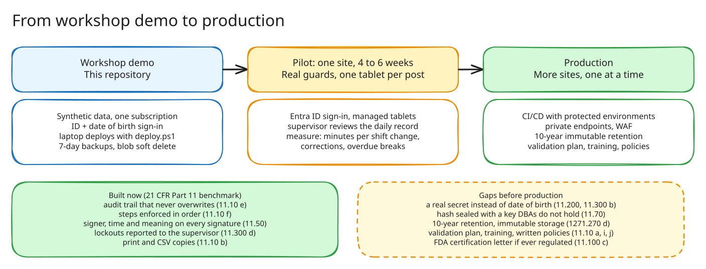

# Security, recovery and pilot path

For the people deciding whether to pilot the timekeeping app. It explains how the
demo protects records, how to recover it, how a pilot could run, and how far the
controls go against 21 CFR Part 11. The demo uses synthetic data only.

## Security

| Area | In the demo | Before production |
|---|---|---|
| Sign-in | Employee ID plus date of birth. Only a salted PBKDF2 hash is stored. Five wrong tries lock the ID for five minutes and report it to the supervisor | Microsoft Entra ID, or a PIN that people choose and change. A date of birth is often known to others |
| Sessions | Signed, HTTPS-only cookie. A guard is signed out after 2 minutes without activity on the shared tablet, a supervisor after 15 | The same, plus device management for the tablets |
| Roles | A guard acts only for themselves. A site supervisor sees one site, a regional supervisor all sites. The relief or cover guard confirms with their own date of birth before signing | Roles from Entra ID groups |
| Web to API | The API answers only requests that carry a shared key, and checks the signed-in person on every action | An Entra token from the web app's managed identity, or private networking |
| Data | No passwords or storage keys exist. The API signs in to PostgreSQL and Blob Storage with its managed identity. Storage is reachable only through a private endpoint | Private endpoints for PostgreSQL and the API, a WAF |
| Admin actions | Reset and Start database. Reset needs a supervisor. Start database needs no sign-in, because nobody can sign in while the database is stopped | Remove both |

## Recovery

| What fails | How it recovers |
|---|---|
| The PostgreSQL server is stopped (some subscriptions stop idle servers overnight) | **Start database** on the Status page, or `deploy.ps1`, which starts it before S1, S2 and S3 |
| Lost or corrupted database data | PostgreSQL keeps 7 days of automatic backups. Restore to a point in time in the Azure portal, then point the API at the restored server by rerunning S2 |
| A signature file deleted or overwritten | Blob soft delete keeps it for 7 days. Undelete it in the portal |
| A broken code release | Rerun `.\deploy.ps1 -StartAt S3` from the last good commit |
| The whole environment | `deploy.ps1` rebuilds it from the Bicep templates in about 25 minutes. The data comes from the backup |

## Pilot path

1. **Workshop demo** (this repository). Synthetic data, one subscription, a laptop
   deploys it.
2. **Pilot at one site, 4 to 6 weeks.** Real guards on one tablet per post, Entra ID
   sign-in, the supervisor reviewing the daily record each morning. Measure:
   - minutes per shift change
   - corrections per 100 shifts
   - overdue breaks
   - time a supervisor spends on the daily review
   - signature verification failures, which should be zero
3. **Production.** Close the gaps below, deploy through CI/CD with protected
   environments, add more sites one at a time.

## Compliance map

21 CFR Part 11 is the FDA rule for trustworthy electronic records and electronic
signatures. Guard timekeeping is not regulated by the FDA, but Part 11 is the
best-known benchmark for records that must stand up to an audit, so the demo is
measured against it. 21 CFR 1271.270 adds rules for keeping records.

**Built** means the demo does it. **Partly** means the demo shows the idea but
production needs more. **Gap** means it is not built.

| Rule | What it asks | Status | How |
|---|---|---|---|
| [11.10(a)](https://www.ecfr.gov/current/title-21/chapter-I/subchapter-A/part-11/subpart-B/section-11.10) | Validated system that can detect altered records | Partly | `Test-Workflow.ps1` runs the whole chain on every deployment. Each signature is checked against its SHA-256. A formal validation plan is a gap |
| 11.10(b) | Accurate copies, readable and electronic | Built | Daily record with print layout and CSV export |
| 11.10(c) | Records retrievable for the retention period | Partly | 7-day database backups and blob soft delete. See 1271.270(d) |
| 11.10(d) | Access limited to authorized people | Built | Sign-in and roles |
| 11.10(e) | Time-stamped audit trail. Changes do not hide earlier entries | Built | Server time on every event. Corrections are separate records, the original is never changed, and the daily record shows both |
| 11.10(f) | Checks that enforce the order of steps | Built | Steps out of order are refused, for example ending a shift during a break |
| 11.10(g) | Only authorized people can sign or act | Built | A guard acts only for themselves. The relief or cover guard confirms their identity before signing |
| 11.10(i), (j), (k) | Training, written signature policies, documentation control | Gap | Organizational. Needed before a pilot |
| [11.50](https://www.ecfr.gov/current/title-21/chapter-I/subchapter-A/part-11/subpart-B/section-11.50) | Signature shows printed name, date and time, and meaning | Built | Shown under every signature and in the CSV, for example *Responsibility: accepts Lobby Desk* |
| [11.70](https://www.ecfr.gov/current/title-21/chapter-I/subchapter-A/part-11/subpart-B/section-11.70) | Signature linked to its record so it cannot be copied to another | Partly | Each event stores its signature's SHA-256 and the signer. Production should seal the hash with a key the database administrators do not hold |
| [11.100](https://www.ecfr.gov/current/title-21/chapter-I/subchapter-A/part-11/subpart-C/section-11.100) | Each signature unique to one person, identity verified, certified to the FDA | Partly | IDs are unique. Identity proofing and the FDA certification letter are organizational gaps |
| [11.200](https://www.ecfr.gov/current/title-21/chapter-I/subchapter-A/part-11/subpart-C/section-11.200) | Two components, such as ID and password | Partly | ID plus date of birth. A date of birth is too easy for others to know. Production needs a real secret |
| [11.300](https://www.ecfr.gov/current/title-21/chapter-I/subchapter-A/part-11/subpart-C/section-11.300)(a), (d) | Unique ID and password pairs; detect and report misuse | Built | Unique badge numbers. Lockouts are recorded and shown to the supervisor |
| 11.300(b), (c), (e) | Password aging, lost-credential handling, device testing | Gap | A date of birth cannot age or be replaced |
| [1271.270](https://www.ecfr.gov/current/title-21/chapter-I/subchapter-L/part-1271/subpart-D/section-1271.270)(a) | Records made at the time of the work, accurate, indelible, naming the person and date | Built | Each step is recorded when it happens, with who did it and who signed in. Nothing is edited |
| 1271.270(b) | Records organized for review | Built | Daily record per site, previous and next day, one place for all records |
| 1271.270(c) | Electronic records backed up | Built | PostgreSQL automatic backups, blob soft delete for signatures |
| 1271.270(d) | Keep records for 10 years | Gap | Needs PostgreSQL long-term backup retention, an immutable (WORM) policy on the signatures container, and Reset removed |

The regulation text is on [eCFR](https://www.ecfr.gov/current/title-21/chapter-I/subchapter-A/part-11).
